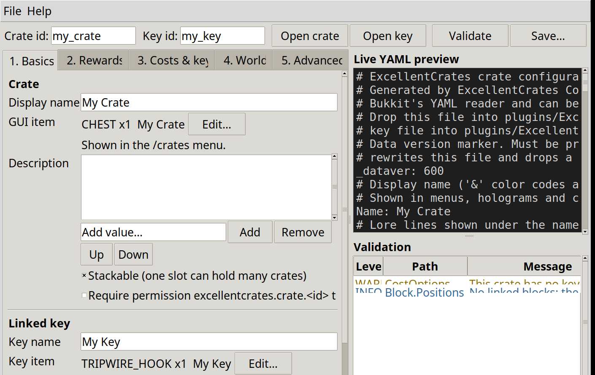

# ExcellentCrates Config Studio

A cross-platform desktop app (Linux / Windows / macOS) that generates the two
YAML files the [ExcellentCrates](https://github.com/nulli0n/ExcellentCrates-spigot)
Spigot plugin reads:

| File | Goes into |
|---|---|
| `crates/<id>.yml` | `plugins/ExcellentCrates/crates/` |
| `keys/<id>.yml` | `plugins/ExcellentCrates/keys/` |

It replaces the in-game `/crates editor` GUI: fill in a guided form, watch the
commented YAML build up live on the right, fix anything the validation panel
flags, and save. The crate's key cost is linked to the generated key file.



## Features

- **Required vs optional, ordered by relevancy** — tabs run Basics → Rewards →
  Costs & key → World → Advanced, matching the order the in-game editor and the
  plugin's `write()` use. Advanced options are collapsed last.
- **Live YAML preview** of both files, regenerated as you type.
- **Validation panel** that mirrors `Crate.collectProblems()` /
  `CrateKey.collectProblems()`, plus the silent-failure cases (unknown rarity,
  unknown particle, invalid animation id, crate/key not linked). Errors block
  saving.
- **Comments in the output** explain every section, valid values and warnings.
  Bukkit's YAML reader ignores them, so the files stay editor-friendly.
- **Import existing files** — open a plugin-written crate/key, edit it, save it.
  Item NBT the editor does not model (enchantments, `custom_data`, …) is kept
  byte-for-byte until you edit that specific item.
- **Round-trip guard** — output is re-parsed and diffed against the in-memory
  model before anything is written; a mismatch refuses to save.

No network access, no server access, no secrets stored (only your last chosen
folders, in `~/.ecstudio.json`).

## Requirements

- Python **3.10+** with Tkinter:
  - Debian/Ubuntu: `sudo apt install python3-tk`
  - Fedora: `sudo dnf install python3-tkinter`
  - Windows / macOS installers ship Tkinter built in
- Nothing else — the app is pure standard library.

## Run

```bash
python3 -m ecstudio
```

(or `python run.py`).

## Usage

1. Set the **crate id** and **key id** in the toolbar (lowercase
   `[a-z0-9_-]` — they become the file names).
2. **Tab 1 Basics** — crate name, GUI item, description, and the linked key's
   name/item.
3. **Tab 2 Rewards** — add item or command rewards, set rarity
   (`common` / `rare` / `mythic` from the plugin's `config.yml`) and weight.
4. **Tab 3 Costs & key** — press **+ key** to create the cost entry that links
   the crate to your key (players consume 1 key per opening), or **+ money**
   for an economy price.
5. **Tabs 4–5** — optional block positions, hologram, particle effect,
   preview/animation menus, cooldowns, permissions, post-open commands,
   milestones.
6. **Save…** — pick the plugin's `crates/` folder once and its `keys/` folder
   once (remembered for next time). Copy the files to your server
   (SFTP/docker mount/panel file manager) and `/crates reload`.

The **Validation** panel double-clicks jump to the offending reward/cost.

## Tests

```bash
python3 -m unittest discover -s tests
```

Covers the YAML emitter/parser (round-trip + PyYAML cross-check against a
plugin-written golden file), SNBT item import/export, the generator, the
validator, file import, and a Tkinter smoke test (skipped automatically if no
display is available).

## Packaging (single-file binary)

```bash
pip install pyinstaller
pyinstaller --clean ecstudio.spec
# → dist/ecstudio/ecstudio  (Linux/macOS)  or  dist\ecstudio\ecstudio.exe
```

Build on each target OS (PyInstaller does not cross-compile). On Windows the
build is windowed (`console=False`); on Linux/macOS the same spec produces the
GUI binary.

## Project layout

| Path | Purpose |
|---|---|
| `docs/schema.md` | Every config key: path, type, default, plugin `file:line` citation |
| `ecstudio/yamlkit.py` | Comment-preserving YAML emitter + parser (stdlib only) |
| `ecstudio/snbt.py` | Item SNBT build/parse, legacy `&`/`§` ↔ text components |
| `ecstudio/model.py` | `CrateConfig`, `KeyConfig`, `Reward`, `Cost`, defaults |
| `ecstudio/generator.py` | Model → ordered, commented YAML (with round-trip guard) |
| `ecstudio/validator.py` | Plugin-side problem checks (error / warning / info) |
| `ecstudio/loader.py` | Import existing YAML back into the model |
| `ecstudio/gui.py` | Tkinter app |
| `ecstudio/data/` | `Material` / `Particle` enum names from spigot-api 1.21.10 |
| `tests/` | Unit + golden + GUI smoke tests |

## Notes

- Generated items omit `DataVersion` (treated as current by the plugin);
  imported items keep the plugin's own value.
- Never-written legacy keys: `Item`, `Key`, `Key.Ids`, `Opening.Cost`,
  `Preview_Config`, `Animation_Config`, reward `Preview` / `Win_Limits`.
- Opening animation ids valid on a fresh server: `csgo`, `enclosing`,
  `mystery`, `roulette`, `storm`, `simple_roll`, `selective_1`,
  `selective_3` (the plugin's own default `default` is *invalid* for
  animations — this app defaults to `simple_roll`).
